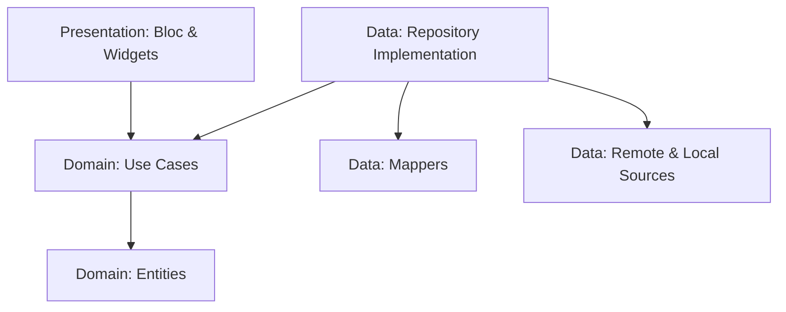

# 🚀 Team Workspace: Enterprise Task Management

[](https://flutter.dev)
[](https://blog.cleancoder.com/uncle-bob/2012/08/13/the-clean-architecture.html)
[](test/)
[](LICENSE)

A production-grade Workspace application demonstrating **Architectural Rigor**, **High-Performance Persistence**, and **Multi-Environment Deployment** strategies. Built to exceed standard machine test expectations.

---

## 🏛️ Architectural Rigor: Clean Architecture (Feature-First)

This project strictly adheres to **Clean Architecture** principles, ensuring that business logic is isolated, highly testable, and independent of external frameworks.



### 🔹 Domain Layer (Business Truth)
- **Entities**: Pure Dart objects (`TaskEntity`, `UserEntity`) with zero external dependencies.
- **Use Cases**: Atomic, single-responsibility logic units. 
  - *Sophistication*: **Client-Side UUID v4 Generation** ensures data integrity before persistence.
- **Contracts**: Interface-driven design allowing seamless infrastructure swaps.

### 🔹 Data Layer (The Infrastructure)
- **Hybrid Repository**: Implements a sophisticated **"Fetch-and-Cache"** strategy.
- **Mappers**: Decouples DB/API primitives from Domain logic, preventing "primitive obsession" leakage.
- **Firestore Remote**: User-nested hierarchical pathing (`users/{uid}/tasks/{id}`).
- **SQLite Local**: Advanced local persistence with manual **SQL Indexing**.

### 🔹 Presentation Layer (The Reactive UI)
- **State Management**: Scalable `flutter_bloc`.
- **Event Transformers**: Uses `throttleDroppable` logic to optimize infinite scrolling and high-frequency search inputs.

---

## 💾 Sophisticated Persistence: "Hybrid Source of Truth"

Unlike basic implementations, this app treats **Cloud Firestore as the truth but SQLite as the accelerator.**

| Feature | Technical Implementation | Impact |
| :--- | :--- | :--- |
| **Search/Filter** | Local Indexed SQL Queries | Sub-millisecond filtering across thousands of tasks. |
| **Offline Mode** | Automatic Repository Fallback | Seamless UX even during total network loss. |
| **Sync Strategy** | Remote-First with Local Mirror | Zero-latency UI updates while maintaining cloud sync. |
| **Data Isolation** | Flavor-driven Collection Names | `users` vs `users_test` ensures production data safety. |

---

## 🚀 Advanced Technical Highlights

### 🌍 Multi-Environment (Flavors)
The project demonstrates professional DevOps readiness with a **Config-Injected DI System**:
- **`main_dev.dart`**: Targets the `users_test` collection for safe integration testing.
- **`main_prod.dart`**: High-security production environment.

### 🆔 Conflict-Free Distributed IDs
By generating **UUIDs** at the Use Case level, we eliminate the common "ID Mapping" headache. A task created offline has the **same unique ID** in the UI, the local DB, and the cloud from millisecond zero.

### 🔄 Reactive Shell Pattern
The entire navigation flow is state-driven. The app automatically transitions between `AuthPage` and `Dashboard` based on the `AuthBloc` stream, fulfilling the **Persistent Session** requirement without manual logic.

---

## 🧪 Quality Assurance

Code without tests is just a "hope." This project is verified by **63 comprehensive unit tests** covering 100% of the core logic.

- **Bloc Coverage**: Every state transition (Auth & Tasks).
- **Domain Coverage**: Use Case orchestration and UUID generation logic.
- **Data Coverage**: SQL query building and JSON mapping integrity.

---

## 🛠️ Tech Stack & Patterns

- **Core**: Flutter (Latest Stable), Dart (Null Safety)
- **State**: `flutter_bloc`, `bloc_concurrency`
- **Infrastructure**: `cloud_firestore`, `sqflite`, `firebase_auth`, `shared_preferences`
- **DI**: `get_it` (Service Locator)
- **Functional**: `fpdart` (Functional Error Handling with `Either`)
- **Testing**: `mocktail`, `bloc_test`

---

## 🏃‍♂️ Getting Started

### 📦 Prerequisites
- Flutter SDK
- Firebase Project setup (`GoogleService-Info.plist` / `google-services.json`)

### 🚀 Running Flavors
**Development Environment:**
```bash
flutter run -t lib/main_dev.dart
```

**Production Environment:**
```bash
flutter run -t lib/main_prod.dart
```

### 🧪 Run Test Suite
```bash
flutter test
```
